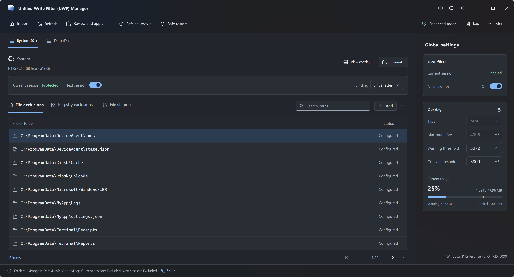
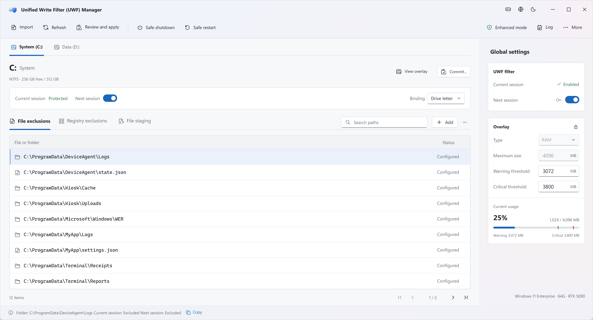

# UWF Manager

A Qt-based graphical management tool for the Windows Unified Write Filter (UWF), with a command-line interface.

[简体中文](README.zh_CN.md)





## About UWF

The [Unified Write Filter](https://learn.microsoft.com/en-us/windows/configuration/unified-write-filter/) is an optional sector-level write-protection component available in Windows Enterprise, Education, IoT Enterprise, and their applicable LTSC editions. Writes to protected volumes are redirected to an overlay in RAM or on disk. Nonpersistent overlays are cleared on restart; persistent disk overlays retain changes across restarts. In normal operation, file and registry exclusions allow specified paths to write directly to the protected volume. Selected overlay changes can also be committed to the protected volume.

UWF exposes current- and next-session state separately. Changes to filter enablement, overlay type and size, and exclusions normally take effect in the next session. Runtime thresholds and immediate commit operations have their own scope.

UWF replaces the earlier Enhanced Write Filter (EWF) and File-Based Write Filter (FBWF). It is suitable for stateless Windows kiosks, point-of-sale terminals, ATMs, medical devices, computer-lab workstations, and digital signage.

## Features

- View the current filter state and configure filter enablement for the next session
- Overlay configuration: type (RAM / Disk), maximum size, warning and critical thresholds
- Advanced overlay settings: Freespace Passthrough, Persistent Overlay, clearing persistent data at the next startup, Read-Only Media mode, and HORM
- Per-volume protection toggle and drive-letter / volume-ID binding
- Per-volume file and directory exclusion management
- Registry exclusion management
- DomainSecretKey / TSCAL persistence switches displayed and controlled directly in the registry exclusion list
- Selective file and registry-value commits, with recursive processing of directories and registry keys; deletion commits for files, directories, registry keys, and named values
- File staging: save a specified file / directory list in the registry and automatically commit its current contents before an in-app safe shutdown or restart
- Overlay file-entry enumeration
- Settings import: paste commands or select command files, then preview and apply
- System restart and shutdown
- In-app log viewer; logs remain in memory and are cleared when the process exits
- Overlay storage-location configuration
- Enhanced mode: use a Windows service to automatically commit eligible staged files before system shutdown or restart

## Requirements

- Windows 10 / 11 Enterprise, Education, IoT Enterprise, or their applicable LTSC editions
- "Unified Write Filter" Windows feature enabled
- Administrator privileges: the main UI requests elevation at startup; commands use the calling process's permissions, so protected operations require an elevated terminal

## Custom configuration

The startup theme, language, and overlay status display (HUB) visibility are configured in a UTF-8 file named **`UWF.ini`** next to the executable:

```ini
[UI]
Theme=dark
Language=en
HubVisible=false
```

| Option | Values | Default |
| --- | --- | --- |
| `[UI] Theme` | `system`, `light`, `dark` | `system` |
| `[UI] Language` | `system`, supported language codes | `system` |
| `[UI] HubVisible` | `true`, `false` | `true` |

Select **Export interface settings** in the About dialog to save the current theme, language, and HUB visibility to `UWF.ini` next to the executable.

## Build

- C++20
- CMake ≥ 3.16
- Qt 6 (Widgets, Svg, Network, LinguistTools)
- A Windows-targeting compiler (MSVC, clang-cl, MSYS2 clang64, mingw-w64)

```sh
cmake -S . -B build
cmake --build build --config Release
```

## AI-generated code

Most of the source in this repository was generated by AI coding assistants under human review and direction. The code is functional, but non-obvious behavior should still be verified against the source, WMI documentation, or the running system before use.

## License

GNU General Public License v3.0 — see [LICENSE](LICENSE).
