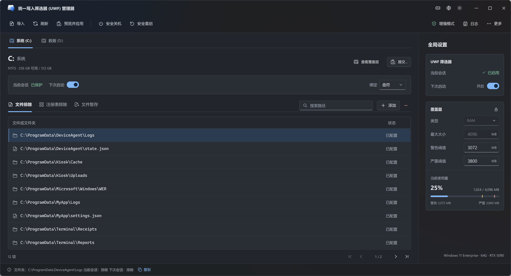
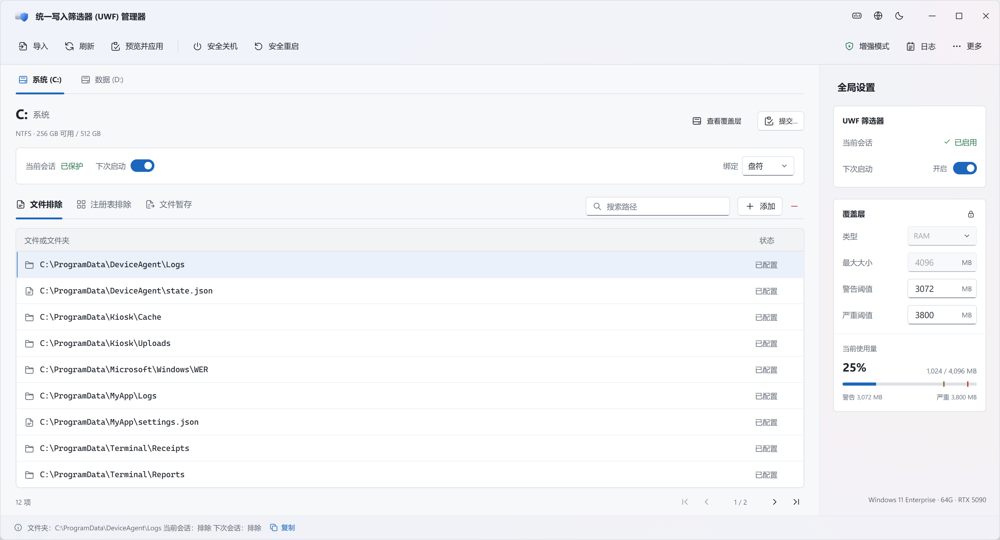

# UWF Manager

Windows 统一写入筛选器（Unified Write Filter, UWF）的 Qt 图形管理器：在系统自带的 `uwfmgr.exe` 命令行之外，提供一个查看和配置 UWF 状态的图形操作界面。

[English](README.md)





## 关于 UWF

统一写入筛选器是 Windows 企业版、教育版、IoT 企业版及对应 LTSC 版本自带的扇区级写保护驱动。当一个卷被设为受保护时，所有对它的写入都会被拦截并重定向到一份 *overlay*（内存中的一块区域，或指定磁盘卷上的一个稀疏文件），底层扇区不会被改动。Overlay 在重启时丢弃，卷恢复到之前的状态。可以声明文件级和注册表项级的排除，让特定路径绕过 overlay 直接写入磁盘；也可以在重启前选择性地把 overlay 中的内容 *持久化*（提交回底层介质）。

UWF 按卷配置，状态分两套并存：*当前*会话（只读，反映驱动此刻在执行的策略）与*下次*会话（可写，重启后生效）。所有配置变更——启用保护、设置 overlay 类型与大小、增加排除项——都作用于下次会话。

UWF 是较早的增强型写保护过滤器（EWF）和基于文件的写保护过滤器（FBWF）的官方继任者，是 Windows 上构建无状态自助机、收银终端、ATM、医疗设备、机房工作站、数字标牌等场景的标准机制。

> **说明**：*服务模式*（`uwfmgr filter enable-servicing` / `disable-servicing`，用于挂起筛选器以执行 Windows Update 或计划维护）没有计划实现。

## 功能

- 筛选器开关，区分当前会话与下次会话
- Overlay 配置：类型（RAM / Disk）、最大容量、警告与紧急阈值
- 单卷保护开关、按盘符 / 按卷 ID 绑定
- 单卷的文件 / 目录排除列表
- 注册表排除列表（系统盘）
- DomainSecretKey / TSCAL 持久化开关，在注册表排除列表中就地展示与切换
- 持久化 overlay 内容到磁盘或注册表（文件、目录、文件删除、注册表键）
- 文件暂存：将用户指定的文件 / 文件夹列表保存到注册表，并在安全关机或重启前自动提交其当前内容
- Overlay 文件条目枚举（只读）
- 导入 uwfmgr 命令——粘贴或从文件加载命令脚本，把每一行转为一条待应用变更
- 系统重启 / 关机
- 程序内置日志查看器
- 默认保持绿色运行——仅文件暂存功能会保存软件自身状态（路径列表写入注册表）；不创建配置文件，内置日志只存在于内存环形缓冲中，进程退出即消失

## 不在计划范围

- HORM（一次休眠、多次恢复，Hibernate Once / Resume Many）
- 服务模式
- 可用空间直通、持久化 overlay、只读介质模式、交换文件创建

## 运行要求

- Windows 10 / 11 企业版、教育版、IoT 企业版或对应 LTSC 版本
- 已启用 "统一写入筛选器" Windows 功能
- 管理员权限——应用变更时需要

注：程序不会因为这些条件不满足而拒绝启动。

## 自定义配置

UWF Manager 不会创建或保存偏好配置文件。如需自定义启动主题或语言，请在可执行文件同目录手动创建名为 **`UWF.ini`** 的 UTF-8 文本文件：

```ini
[UI]
Theme=dark
Language=zh_CN
```

| 选项 | 可选值 | 默认值 |
| --- | --- | --- |
| `[UI] Theme` | `system`、`light`、`dark` | `system` |
| `[UI] Language` | `system`、`en`、`zh_CN` | `system` |

`system` 表示启动时使用 Windows 应用主题或系统语言。语言支持英文（`en`）和简体中文（`zh_CN`）；系统语言不在支持范围内时使用英文。配置值不区分大小写，两个选项均可省略。即使可执行文件名含版本号，配置文件名也始终为 `UWF.ini`；请确认没有误存为 `UWF.ini.txt`。

配置仅在新的 UI 实例启动时读取一次，静默启动到托盘时同样生效。查找位置以可执行文件所在目录为准，不受工作目录影响。编辑后需退出并重新启动 UI 进程；已有实例运行时，再次启动程序不会重新加载配置。工具栏的主题和语言切换只影响本次运行，不会回写文件。

文件或选项缺失时保持默认行为。非法选项会被忽略，不影响其他有效选项，并在内置日志中记录警告；文件不可读或格式错误时回退默认配置，不弹窗、不阻碍启动。程序不会创建、修改或修复 `UWF.ini`，也不会把这些偏好写入注册表或其他目录。删除文件后，下次启动恢复默认行为。文件暂存和增强模式服务配置仍按各自功能独立管理。

## 构建

- C++20
- CMake ≥ 3.16
- Qt 6（Widgets、Svg、LinguistTools）
- Windows 目标编译器（MSVC、clang-cl、MSYS2 clang64、mingw-w64）

```sh
cmake -S . -B build
cmake --build build --config Release
```

## 由 AI 生成的代码

本仓库中的大部分源码由 AI 编程助手在人工审阅与指导下生成。使用时请相应对待：代码可运行，但任何非显而易见的行为，请在依赖前对照源码、WMI 文档或运行中的系统加以验证。

## 许可

GNU General Public License v3.0，见 [LICENSE](LICENSE)。
