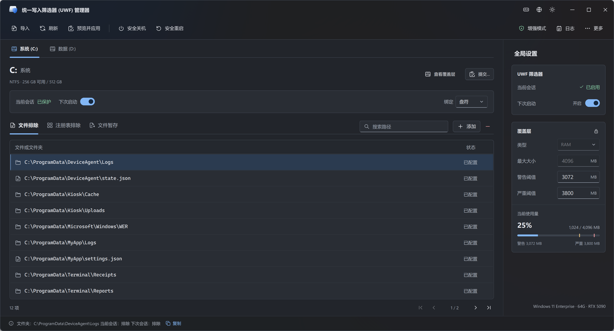
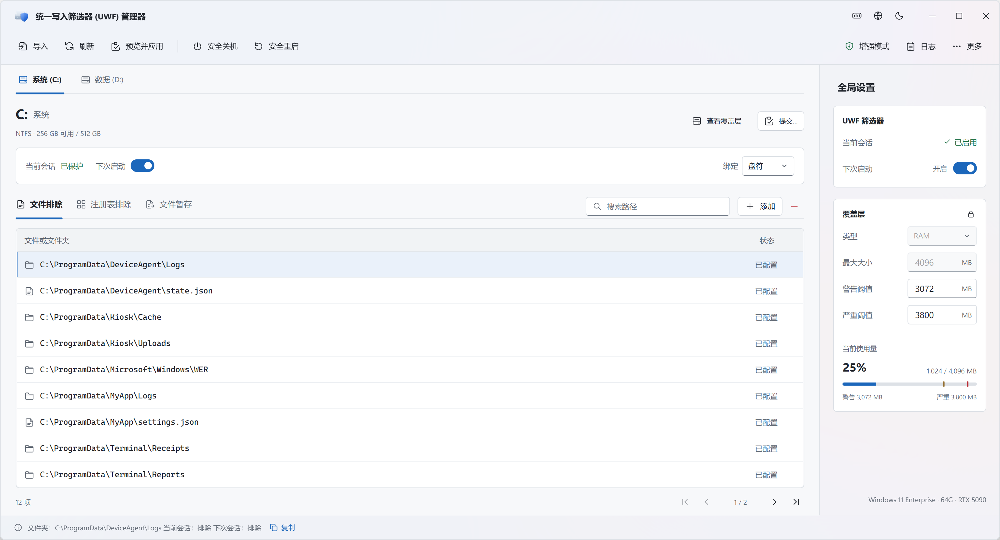

# UWF Manager

基于 Qt 的 Windows 统一写入筛选器（Unified Write Filter，UWF）图形管理工具，同时提供命令行接口。

[English](README.md)





## 关于 UWF

[统一写入筛选器](https://learn.microsoft.com/zh-cn/windows/configuration/unified-write-filter/)是 Windows 企业版、教育版、IoT 企业版及相应 LTSC 版本提供的可选扇区级写保护组件。它将受保护卷的写入重定向到 RAM 或磁盘覆盖层。非持久覆盖层在重启后清空，持久磁盘覆盖层则保留更改。常规模式下，文件和注册表排除项允许指定路径直接写入受保护卷，也可选择性地将覆盖层中的更改提交到受保护卷。

UWF 分别提供当前会话和下次会话的状态。筛选器开关、覆盖层类型与容量、排除项变更通常在下次会话生效；运行时阈值与即时提交操作有各自的生效范围。

UWF 取代了早期的增强型写入筛选器（EWF）和基于文件的写入筛选器（FBWF），适用于 Windows 无状态自助终端、收银终端、ATM、医疗设备、机房工作站和数字标牌等场景。

## 功能

- 查看当前筛选器状态，设置下次会话的筛选器开关
- 覆盖层配置：类型（RAM / Disk）、最大容量、警告阈值与严重阈值
- 覆盖层高级设置：可用空间直通、持久覆盖层、下次启动清除持久数据、只读媒体模式与 HORM
- 单卷保护开关及盘符 / 卷 ID 绑定
- 按卷管理文件与目录排除项
- 注册表排除项管理
- DomainSecretKey / TSCAL 持久化开关，在注册表排除列表中直接显示与切换
- 选择性提交文件和注册表值；支持按目录或注册表键递归处理，以及文件、目录、注册表键和命名值的删除提交
- 文件暂存：将指定的文件 / 目录列表保存到注册表，在应用内安全关机或重启前自动提交其当前内容
- 覆盖层文件条目枚举
- 导入设置：粘贴命令或选择命令文件，预览后应用
- 系统重启与关机
- 内置日志查看器，日志仅存于内存，进程退出后清除
- 覆盖层存储位置配置
- 增强模式：通过 Windows 服务，在系统关机或重启前自动提交符合条件的暂存文件

## 运行要求

- Windows 10 / 11 企业版、教育版、IoT 企业版或相应 LTSC 版本
- 已启用“统一写入筛选器”Windows 功能
- 管理员权限：主界面启动时请求提升权限；命令接口使用调用进程的权限，受保护操作需在管理员终端中执行

## 自定义配置

启动主题、语言和覆盖层状态组件（HUB）的显示状态通过可执行文件同目录的 UTF-8 配置文件 **`UWF.ini`** 设置：

```ini
[UI]
Theme=dark
Language=zh_CN
HubVisible=false
```

| 选项 | 可选值 | 默认值 |
| --- | --- | --- |
| `[UI] Theme` | `system`、`light`、`dark` | `system` |
| `[UI] Language` | `system`、受支持的语言代码 | `system` |
| `[UI] HubVisible` | `true`、`false` | `true` |

在“关于”对话框中选择“导出界面设置”，可将当前主题、语言和 HUB 显示状态保存为同目录的 `UWF.ini`。

## 构建

- C++20
- CMake ≥ 3.16
- Qt 6（Widgets、Svg、Network、LinguistTools）
- Windows 目标编译器（MSVC、clang-cl、MSYS2 clang64、mingw-w64）

```sh
cmake -S . -B build
cmake --build build --config Release
```

## 由 AI 生成的代码

本仓库的大部分源码由 AI 编程助手在人工审阅与指导下生成。代码可运行，但对非显而易见的行为，仍应在使用前对照源码、WMI 文档或实际系统验证。

## 许可

GNU General Public License v3.0，见 [LICENSE](LICENSE)。
